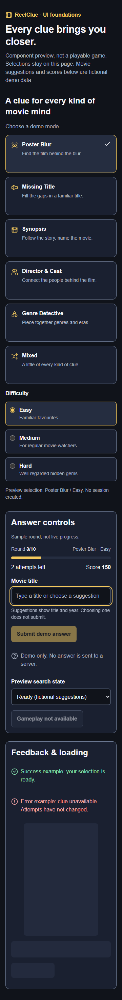
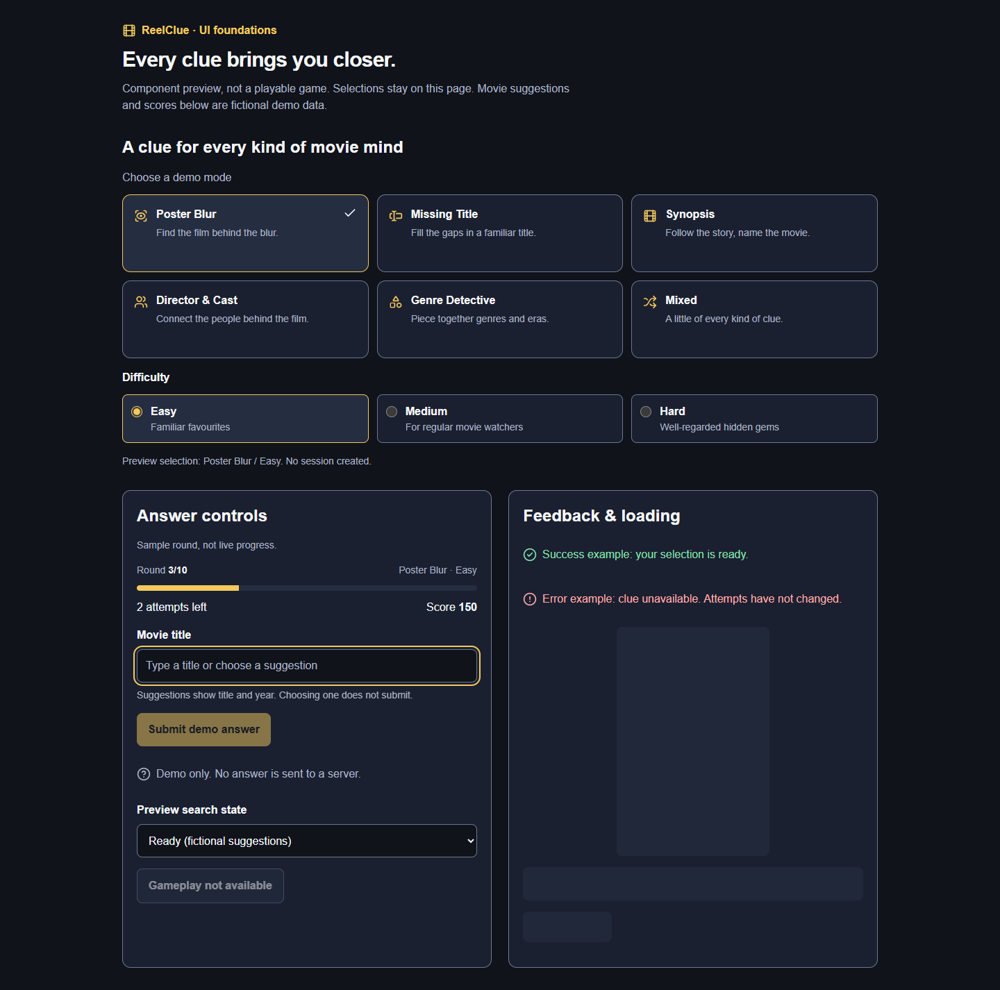
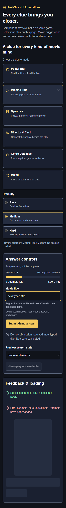

# RC-003 — UI foundations validation

4 November 2026. Branch `feat/rc-003-ui-foundations`, based on merged RC-002 (`2122286`, PR #30). Scope: issue #3 only. Candidate design baseline awaits Andre's review; no merge or next-ticket authorization implied.

## Behavior

- One semantic dark/amber Tailwind/shadcn token system, system typography, 4px space scale, solid keyboard focus and reduced-motion support.
- Adapted shadcn Button/Input/Skeleton; labelled six-mode radio cards, familiarity-level radios, round header/progress, polite icon/text feedback and loading skeleton.
- Editable combobox foundation accepts parent-provided title/year/opaque-handle choices, caps display at eight, preserves focus during selection, supports arrows/Enter/Escape/Tab and guards IME Enter. Open-list Enter never submits; closed-list Enter can submit parent form. Loading/error suppress stale choices. Parent clears selected identity on editing.
- `/ui-preview` is a noindex, clearly labelled component demo with fictional suggestions, fixed sample progress and local interactions. Home stays placeholder. No real scoring, session creation, network search, persistence or provider calls.
- Added only `clsx@2.1.1`, `tailwind-merge@3.7.0`, `lucide-react@1.67.0`; no framework upgrade, animation library or extra test framework.

## Commands and results

| Command | Final result |
| --- | --- |
| `pnpm lint` | Passed, zero warnings |
| `pnpm typecheck` | Passed, generated route types and strict TypeScript |
| `pnpm test` | Passed, 2 files / 15 tests, including 8 UI-foundation tests |
| `pnpm build` | Passed, static `/`, `/_not-found`, `/ui-preview` |
| `pnpm start --hostname 127.0.0.1 --port 3002` | Production build served for final browser checks |

Earlier contrast check correctly failed `input/accent` at 2.9223:1. Raised border/input token from `#67748E` to `#6B7892`; final token checks pass. Browser review also caught green native progress and dark selected-option text on hover; explicit native progress styling and conditional hover background fixed both.

Unit checks cover native control labels/selection/disabled state, combobox ARIA relationships and years, keyboard/pointer selection, no automatic submission, editing/blur/Escape, IME Enter, loading/error/input retention, eight-option cap/empty state and actual CSS token contrast. Existing bootstrap/environment tests remain green. Tests use existing Vitest/Testing Library setup.

## Actual browser validation

Headless installed Chrome via existing cached Playwright tooling, Windows, against production server; no browser package added to application. Scripted assertions passed:

| Viewport | Result |
| --- | --- |
| 320×800 | No horizontal overflow, input ≥16px, targets ≥44×44px, long suggestions wrap |
| 360×800 | Same; phone screenshot |
| 390×844 | Same; keyboard/error screenshot |
| 768×1024 | Same; two-column sample panels |
| 1440×1000 | Same; desktop screenshot |

Keyboard run verified mode radio arrows, level radio arrows, tab into input, solid focus outline, selecting remake year without submission, focus retained, subsequent closed-list Enter submission, free-text editing, open-empty-list Enter blocked, Escape then Enter submission, failed-search text retention and zero active animations under reduced motion. Selected-option hover retains amber background. No browser JS errors or external requests observed. Desktop screenshot visually confirms amber progress fill; Chromium computed-style inspection of native internal pseudo-elements was not reliable and is not used as proof.

Screenshots visually reviewed for wrapping, spacing, state distinction and focus:

| Phone 360px | Desktop 1440px |
| --- | --- |
|  |  |

## Manual review

1. Run `pnpm install --frozen-lockfile`, `pnpm build`, then `pnpm start`. Open `/ui-preview`.
2. Resize to 320, 360, 390, 768 and 1440px. Confirm no horizontal scrolling; labels and long suggestions wrap. Desktop content remains bounded; phone scrolls normally.
3. Use Tab and arrow keys through mode and difficulty groups. Confirm selected labels/checks and amber focus remain visible. Selection must not navigate or create a session.
4. Focus Movie title. Arrow to second fictional title/year, press Enter. Confirm input updates but demo submission feedback does not. Press Enter again with list closed; confirm local-only submission feedback.
5. Edit text, confirm no stale selected year on submission. Test Escape, Tab, pointer selection and a long suggestion. Test Loading and Recoverable error using labelled preview selector; text must remain unchanged and stale suggestions must disappear.
6. Enable OS/browser reduced motion. Confirm skeleton stops pulsing. Inspect success/error words and icons; disabled controls must not act. Review Master and semantic tokens before approving visual direction.

## Limits

No physical Safari/iOS keyboard, screen reader or WebKit run claimed. No playable game or API boundary exists yet. RC-010 owns actual catalog search, debounce/cancellation and endpoint behavior. Later gameplay tickets own mutation/submitting/reveal/advance states and server-authoritative rules; launch QA owns complete-device coverage. No TMDB artwork or secret appears in evidence. Full-product accessibility compliance and performance targets are not claimed.

Design-search outcomes, rejected recommendations, candidate Master path, semantic mapping and UI checklist are recorded in [UI skill setup](UI-SKILL-SETUP.md#rc-003-usage-evidence).
